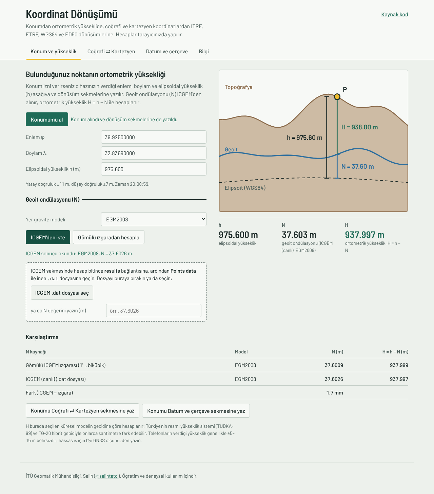
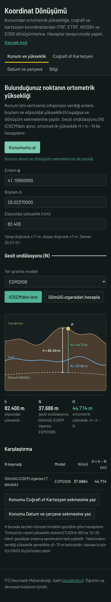

# Koordinat Dönüşümü — Web

**Site:** [salihtatci.github.io/new_coordinate_trans_web](https://salihtatci.github.io/new_coordinate_trans_web/)

Tarayıcıda çalışan jeodezik koordinat dönüşümü. İzin verirseniz bulunduğunuz konumu alır, dönüşüm kutularına yazar, geoit ondülasyonunu (N) **ICGEM**'den ister ve **ortometrik yüksekliği (H = h − N)** hesaplar. Hesap çekirdeği, [coordinate_transformation](https://github.com/salihtatci/coordinate_transformation) deposundaki Python/Kivy uygulamasının (`jeodezi.py`) birebir JavaScript karşılığıdır.

<p align="center">
  
  
</p>

## Neler yapar

- **Konum ve yükseklik**: tarayıcının konum servisiyle φ, λ ve h alınır (izin ister, yalnızca https'te çalışır); N bulunur, H = h − N hesaplanır. Yükseklik kesiti çizimi h, N ve H'yi gösterir; farklı N kaynakları bir tabloda karşılaştırılır.
- **Coğrafi ⇄ Kartezyen**: GRS80, WGS84, Hayford, Krassovsky, Bessel; ters çözüm iteratif ya da Bowring.
- **Datum ve çerçeve**: IERS 14 parametre (zamana bağlı), hızsız 7 parametre, Bursa-Wolf (PV/CF), Molodensky-Badekas, yalnız elipsoit değişimi. ITRF2020…ITRF96, ETRF2000, WGS84 (G2296/G2139/G1762), ED50. Parametreler kayıtlı setlerden otomatik seçilir; manuel giriş de yapılabilir.
- Her dönüşüm sekmesinde **Konumumu kullan** düğmesi vardır.

## Elipsoidal yükseklik (h) nereden gelir?

| Cihaz | Ne olur |
| --- | --- |
| **Android telefon** (açık havada) | Tarayıcı yüksekliği WGS84 elipsoidine göre verir, doğrudan h olur. İlk konum çoğu zaman yüksekliksiz gelir; site o arada h'yi arazi modelinden doldurur, GPS'i 20 saniye dinler ve yükseklikli konum gelince GPS değerini yazar. |
| **iPhone, iPad, Mac** | Apple yüksekliği deniz seviyesine göre (EGM2008) verir. Site h = H<sub>cihaz</sub> + N − 0.41 m ile elipsoidal yüksekliğe çevirir. |
| **Bilgisayar** | GPS yok; konum Wi-Fi/IP'den gelir, yükseklik verilmez. Site bu durumda h'yi otomatik olarak arazi modelinden doldurur (Konum ve dönüşüm sekmelerinin hepsinde): Copernicus DEM GLO-90 yüksekliğini ([Open-Meteo](https://open-meteo.com/en/docs/elevation-api) üzerinden, EGM2008'e göre) alır ve h = H<sub>DEM</sub> + N − 0.41 m hesaplar. Tahmindir: model bina ve ağaçları içerebilir, belirsizlik birkaç metredir. |
| **GNSS alıcısı** | Hassas iş için h'yi ölçünüzden kutuya yazın. |

0.41 m, ICGEM ile NGA'nın EGM2008 geoidi arasındaki sıfırıncı derece farkıdır (Ankara 0.413 m, İstanbul 0.411 m; GeographicLib ile karşılaştırıldı).

**Konum izni kapalıysa** site hangi cihazda açıldığını tanır ve izni açmanın adımlarını gösterir. iPhone'da izin telefon ayarlarındadır: **Ayarlar → Gizlilik ve Güvenlik → Konum Servisleri** açık olmalı, aynı listede **Safari Web Siteleri** için **Uygulamayı Kullanırken** seçilmeli ve **Hassas Konum** açık olmalı; ayrıca **Ayarlar → Uygulamalar → Safari → Konum** (eski iOS'ta **Ayarlar → Safari → Konum**) **Sor** ya da **İzin Ver** olmalı. WhatsApp, Instagram gibi uygulamaların kendi tarayıcıları konumu engelleyebilir; sayfayı Safari ya da Chrome'da açın.

## Geoit ondülasyonu (N) nereden geliyor?

ICGEM (GFZ Potsdam) herkese açık bir API sunmaz ve tarayıcılara başka sitelerden veri okuma izni (CORS) vermez. Site N'yi üç yoldan alır:

| Yol | Nasıl çalışır |
| --- | --- |
| **Gömülü ICGEM ızgarası** | ICGEM'in ızgara servisinde hesaplatılan EGM2008 geoit ızgarası (`egm2008_tr_1dk.bin`: 1′ aralık, 35.5–42.5° K, 25.5–45° D). Konum alınınca otomatik, internetsiz çalışır. ICGEM nokta servisiyle 40 bağımsız noktada en büyük fark 9.7 mm, RMS 4.0 mm. |
| **ICGEM'den iste (yeni sekme)** | İstek ICGEM'in nokta hesap servisine yeni sekmede gönderilir (~25 s). **results → Points data** ile inen `.dat` dosyası sayfaya bırakılınca N otomatik okunur. |
| **ICGEM'den iste (otomatik)** | `worker.js` (Cloudflare Worker) isteği sunucu tarafında yapar; adresi `config.js` içindeki `icgemProxyUrl`'e yazılırsa düğme sonucu kendisi getirir. |

ICGEM ayarları: fonksiyonel `geoid`, referans sistem WGS84, sıfırıncı derece terimi dahil, modelin kendi gelgit sistemi. Modeller: EGM2008 (varsayılan), XGM2019e_2159, EIGEN-6C4, SGG-UGM-2, EGM96.

## Dosyalar

Site dosyalarının hepsi aynı klasördedir (alt klasör yok); GitHub'ın web yükleyicisiyle doğrudan köke yüklenebilir.

| Dosya | Görevi |
| --- | --- |
| `index.html`, `style.css` | Sayfa ve görünüm |
| `jeodezi.js` | Hesap çekirdeği (`jeodezi.py`'nin karşılığı) |
| `geoit.js` | Gömülü ızgara, ICGEM istekleri, `.dat` okuyucu, H = h − N |
| `app.js` | Arayüz ve konum servisi |
| `config.js` | İsteğe bağlı ICGEM proxy adresi |
| `egm2008_tr_1dk.bin` | ICGEM EGM2008 geoit ızgarası (Türkiye, 1′, 0.99 MB) |
| `.nojekyll` | GitHub Pages'in dosyaları olduğu gibi yayınlaması için |
| `worker.js`, `wrangler.toml` | İsteğe bağlı otomatik ICGEM proxy'si |

## Yayınlama ve yerelde çalıştırma

GitHub Pages: **Settings → Pages → Deploy from a branch → `main` / `(root)`**.

Yerelde (`index.html`'i çift tıklamak yerine; gömülü ızgara dosyadan açılan sayfada yüklenemez):

```bash
python -m http.server 8000
# tarayıcıda http://localhost:8000
```

## Otomatik ICGEM proxy'si (isteğe bağlı)

1. Ücretsiz Cloudflare hesabında **Workers & Pages → Create Worker**, adı `icgem-proxy`; **Edit code**'a `worker.js` içeriğini yapıştırıp **Deploy**. Ya da bu klasörde `npx wrangler login && npx wrangler deploy`.
2. Worker değişkeni: `IZINLI_KOKEN = https://salihtatci.github.io`.
3. Deneme: `https://icgem-proxy.<hesabınız>.workers.dev/?lat=39.925&lon=32.8369` yaklaşık 25 saniyede `"N": 37.6026...` döndürür.
4. `config.js` içinde `icgemProxyUrl: "https://icgem-proxy.<hesabınız>.workers.dev"` yazıp yükleyin.

## Uyarılar

- H, seçilen küresel modelin geoidine göredir; TUDKA-99 ve TG-20 hibrit geoidiyle onlarca santimetre fark edebilir.
- ICGEM'in sıfırıncı derece terimi yalnızca GM farkını içerir. NGA'nın resmî EGM2008 değerleri W0 − U0'ı da içerdiğinden ICGEM'den yaklaşık 0.41 m küçüktür: Ankara'da (39.925°, 32.8369°) ICGEM 37.603 m, GeographicLib GeoidEval 37.189 m verir.
- Telefonların verdiği yükseklik genellikle ±5–15 m belirsizdir; hassas iş için h'yi GNSS ölçünüzden yazın.
- IERS, EUREF ve EPSG parametreleri ders amaçlıdır; resmî işlerde güncel tablolarla karşılaştırın.

Geoit verisi: [ICGEM, GFZ Potsdam](https://icgem.gfz.de/). EGM2008: Pavlis vd. (2012), JGR 117, B04406. Arazi yüksekliği: Copernicus DEM GLO-90 (Copernicus programı, Avrupa Birliği ve ESA), Open-Meteo Elevation API.

İTÜ Geomatik Mühendisliği, Salih ([@salihtatci](https://github.com/salihtatci)).
